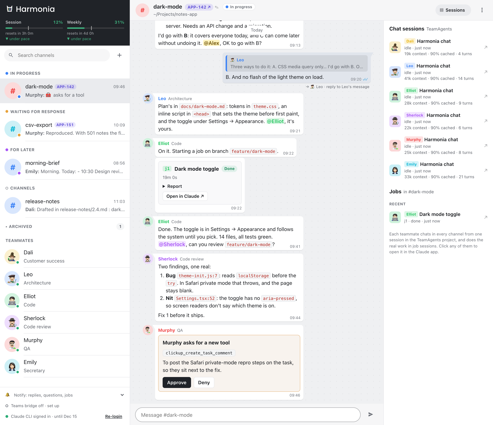
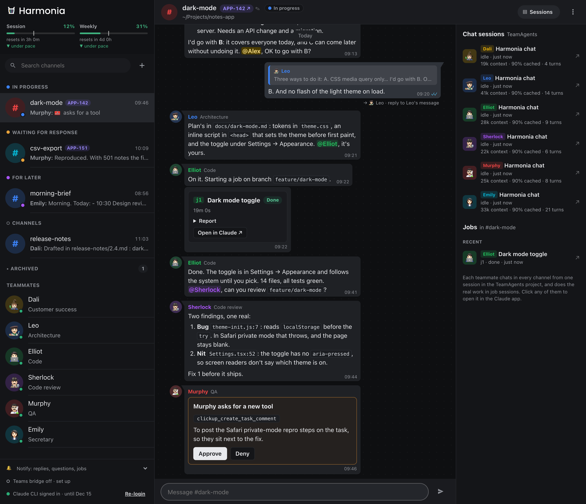

# Team chat

A local group chat, laid out like WhatsApp, with the six teammates in `~/.claude/agents`
(Dali, Leo, Elliot, Sherlock, Murphy, Emily).



Each teammate is a Claude Code agent. They talk in channels, hand work to each
other with @mentions, and start Claude Code jobs for real work. You approve
their permissions and new tools from cards in the chat.

| Replies and Mozart | Right-click menus | A teammate's settings |
| --- | --- | --- |
|  |  |  |
| A reply wakes only the teammate you reply to. A message that names nobody goes to whoever the channel's Mozart picks. | Right-click a message, a channel or a teammate. | Name, role, routing keywords, avatar, colour, and the chat session's model and effort. |

<details>
<summary>Dark mode</summary>



</details>

The screenshots use made-up demo data: `docs/screenshots/demo-data.py` builds it,
and `docs/screenshots/capture.mjs` takes them.

## Install

```bash
curl -fsSL https://raw.githubusercontent.com/ShaharIlany/team-chat/main/install.sh | bash
```

You need an Apple Silicon Mac and the
[Claude Code CLI](https://claude.com/claude-code), signed in. Nothing to build:
the script downloads the latest release, checks it against its SHA-256,
installs it in `~/Applications` and opens it. It also adds the six starter
teammates to `~/.claude/agents` (see [agents/README.md](agents/README.md)),
leaving any file you already have alone. From then on the app updates itself
from new releases. Run the script again any time to reinstall.

To build it yourself instead (an Intel Mac, or to follow a branch):
`TEAM_CHAT_FROM_SOURCE=1` before `bash`. That needs Xcode's command line tools
(`xcode-select --install`) and [Bun](https://bun.sh).

## Releases

Every version tag is a release, built on GitHub
([.github/workflows/release.yml](.github/workflows/release.yml), on an Apple
Silicon runner):

```bash
git tag v1.2.0 && git push origin v1.2.0
```

It builds the app with `build.sh` and publishes `Team-Chat-arm64.zip` (about
20 MB) with its `.sha256`. Pushing to `main` alone ships nothing.

## Team Chat.app

From a checkout:

```bash
macapp/build.sh --install   # builds build/Team Chat.app and copies it to ~/Applications
```

The app is a native window (`macapp/main.swift`, WKWebView) around the server,
compiled with `bun build --compile main.ts` into
`Contents/Resources/team-chat-server`. The page, the prompt templates and the
default `team.json` are embedded. The same binary runs the chat sessions' job
tools (`team-chat-server --job-tools`).

- **Data:** `~/Library/Application Support/Team Chat` (channels, messages, chat
  sessions, `team.json`). `settings.json` there holds `teamAgentsDir`
  (default `~/TeamAgents`), `defaultCwd` (default `~`), and for ClickUp
  `clickupWorkspace` and `clickupTaskPrefix` (say `ABC` for task ids like
  `ABC-123`). The first `--install` writes it and copies `data/` over.
- **Server:** started on 127.0.0.1:4747 with your login shell's PATH, so jobs
  find git, bun and your other tools. If something already answers on 4747 (say
  `bun server.ts`), the app shows that instead of starting a second one. Log:
  `~/Library/Logs/Team Chat/server.log` (View → Show Server Log).
- **Window:** closing it keeps the team running; click the Dock icon to bring it
  back. Quit (⌘Q) stops the server, and asks first if a teammate or job is still
  working. The Dock badge counts teammates' messages that came while you weren't
  looking (another channel, or the app in the background); muted channels
  don't count. Links open in your browser;
  View → Open in Browser shows the same chat in Chrome.
- **Notifications:** whenever you're not looking at a channel (another channel,
  the window hidden, or the app in the background), a teammate's reply, a
  question for you, a permission card, an error or a finished or failed job
  becomes a macOS notification. The 5-minute job status updates don't. A
  question for you also bounces the Dock icon once. Clicking a notification
  opens its channel. The 🔔 setting at the bottom of the sidebar switches
  between all of these, only @mentions of you, or off (saved per browser). In
  a browser they're web notifications.
- **Updates over the air:** every 30 minutes the app asks GitHub for the
  repo's latest release (`updates.ts`; the repo is in `build.json`, written by
  `build.sh`). When it's newer than the running version, the app downloads the
  zip in the background, checks its SHA-256, unpacks it and signs it ad hoc. It swaps the new build in when no
  teammate or job is working and you haven't sent anything for 10 minutes: the
  server moves the running build to `previous/` in the data folder, puts the
  new one in its place and exits, and the app reopens itself on the new build.
  (A helper that outlives the app can't do it: macOS ends everything an app
  started when it quits.) The chat list's footer shows an update while it's
  pending, with **Restart to update** to install it as soon as nobody's
  working. Team Chat → Check for Updates… checks now. A build without a
  version (made from source) counts as older than any release.
  `settings.json`: `updateRepo` (`owner/name`), `autoUpdate: false` to only
  show updates, and `"updateFrom": "source"` to follow a branch's commits
  instead (`updateBranch`): the app then fetches them into its own clone
  (`source/` in the data folder) and builds them there with `build.sh`, which
  needs git, bun and Xcode's command line tools. Log: `update.log` in the data
  folder.
- **After a code change:** run `build.sh --install` again and reopen the app,
  or tag a release and let the app update itself. The old build goes to the
  Trash. (A build from source updates itself to the next release, unless
  `updateFrom` is `source`.)

To run from source instead: `TEAM_CHAT_DATA="$HOME/Library/Application Support/Team Chat" bun team-chat/server.ts`
or `bun run stub` to try the UI.

No dependencies, no API key: everything runs on the `claude` CLI sign-in.

## Chat sessions and jobs

Every teammate has two kinds of Claude Code session:

- **One chat session**, in the **TeamAgents** project (`~/TeamAgents`, `teamAgentsDir`
  or `TEAM_AGENTS_DIR`). It's the same session for every channel, titled
  `[Name] Team chat`. It answers in the chat, asks you questions, and decides
  per request whether to do it itself or start a job. It runs as an inline
  agent (`--agents`) with the agent's own tool allowlist minus file edits
  (`Edit`, `Write`, `NotebookEdit`), so quick lookups (an email, a meeting, a
  ClickUp task, a file, `git status`) and Outlook drafts happen in the chat
  turn. It also gets `start_job`, `check_jobs` and `stop_job` (`job-tools.ts`, a
  stdio MCP server that calls back into the app with a token that's valid for
  that turn only). Its system prompt is `chat-rules.md` plus the agent's
  instructions. Model and
  effort are set per teammate on its settings page ("Chat side").
- **Jobs** for the real work: `claude -p --agent <id>` in the channel's folder,
  one session per job, titled `[Name] #channel · title`, with the agent's tools,
  memory, model and effort from `~/.claude/agents/<id>.md` and `job-rules.md`
  appended. Each appears as a card in the chat and in the sessions panel. When
  it finishes, its report goes back to the teammate's chat session as an event.

**Prompt caching.** All chat turns run in one folder. The chat system prompt
holds nothing per channel or per turn, and each turn only appends the channel's
new lines, so the cached prefix stays put. Runs set
`CLAUDE_CODE_PROMPT_CACHE_TTL=1h`. Hover a message's time, or look at the
sessions panel, to see how much input came from the cache.

**Plan usage.** The top of the sidebar shows your Claude plan's 5-hour and
weekly usage, with when each resets. Every CLI run reports them (the
`rate_limit_event` in its stream). When nothing has reported them for 5 minutes
and the page is open, the server runs a one-word Haiku probe with no tools and
no saved session. They count all your Claude use, not just this app. No dollar
amounts are shown. The bars pace you the same way as the `usage-limits-band`
Claude Code mod: a grey marker shows where usage would be now if spread evenly
over the window, the fill turns amber or red when you're 5 or 15 points ahead
of it (or past 80% / 90%), and a line says whether you're on pace and, if
you're running hot, when you'd run out before the reset.

**One reply at a time.** A teammate's chat session answers one channel at a
time. Other channels that need it wait in a queue (the typing bar says "busy in
#x, then here"). Jobs run in parallel and don't block the chat.

**Start a fresh session** on a teammate's page forgets the chat conversation.
Jobs and memories stay.

## How it behaves

- **Who answers: Mozart.** `@Name` anywhere, or `Name, …` at the start, goes
  straight to that teammate, and so does a reply to a teammate's message.
  Anything else, the channel's **Mozart** decides (`mozart.ts`,
  `mozart-rules.md`): one teammate, several, or nobody. Each channel has its
  own Mozart, a Claude Code session on Haiku 5.5 with no tools, so it knows
  the channel's conversation: who asked you what, who you're talking with,
  whose work a new topic is (by each teammate's role and *routing keywords*,
  teammate page → Profile). Each decision appends only the new lines, so the
  rest comes from the prompt cache; it takes about 2 seconds. Nothing shows
  while it thinks: the teammate it picks starts typing. Its pick shows under
  the message: "🎼 Mozart → Elliot · Elliot's code fix". Its sessions run in
  `mozart/` in the data folder, titled `[Mozart] #channel`, and start over
  when one grows past 60k tokens. If a decision fails or takes over 45 s, a
  rule decides instead: a teammate waiting on your answer gets it, else the
  teammate you were just talking with, else Emily ("→ Emily · nobody in the
  conversation (Mozart failed)").
- **After a teammate's message, too.** A teammate's `@Name` wakes that
  teammate (a handoff), unless it's in the same sentence as a question to you,
  and a question to you waits for you. Otherwise Mozart reads the reply and
  decides whether anyone follows up: usually nobody, but "Murphy, can you try
  to break it?" without the `@` wakes Murphy. A note shows only when it wakes
  someone.
- **Protected folders:** every `claude` the app starts runs in a macOS
  sandbox (`sandbox.ts`, `sandbox-exec`) that blocks the folders macOS asks
  permission for: Desktop, Documents, Downloads, Music, Pictures, Movies,
  iCloud Drive, `~/Library/CloudStorage`, Mail, Messages, Safari, Calendars,
  Contacts, Notes, Reminders, other apps' data (`~/Library/Containers`) and
  `/Volumes`. A teammate gets "Operation not permitted" there, so it never
  triggers a permission prompt for Team Chat. It can move things into the
  Trash but not look inside. Allowed anyway: the channel's own folder, and
  anything in `settings.json` `"protectedAllow": ["~/Downloads"]` (read on
  every turn, no restart). `"protectedGuard": false` turns the sandbox off.
  A sandboxed process can't start its own sandbox: Chrome needs
  `--no-sandbox` (Playwright's default) and `swift build` needs
  `--disable-sandbox`.
- **Feedback:** ✎ next to React and Reply on a teammate's message (or
  "Feedback for …" in its ⌄ menu) opens a box for your feedback; Enter sends,
  Shift+Enter adds a line. It's posted in the channel as a reply to that
  message, and starts a job for the teammate who wrote it, with
  `feedback-rules.md` around it: the message, the 40 messages before it, the
  job's brief and report when it's a job card, the teammate's instructions
  file and memories, and the team rules. The teammate works out how its rules
  led to the message and amends its own instructions to include the feedback,
  keeping every intended behavior and the file as short as it can. Its report
  comes back in the chat like any job's.
- **Handoffs:** a teammate's `@Name` wakes that teammate, unless it's in the
  same sentence as a question to you. Teammates write a name without `@` when
  they don't need that person yet (Mozart still decides whether they're
  needed now). A woken teammate first checks it's really
  its turn; if not, it answers `(no reply)` and nothing is posted (chat-rules.md,
  "Is it your turn?"). After 8 agent turns without you, the chat pauses.
- **Job status updates:** every 5 minutes while a job runs
  (`TEAM_CHAT_STATUS_MINUTES`), its teammate posts what's happening, what's
  done and what the job is waiting for. A one-shot Haiku call (`quickAnswer`
  in `runner.ts`, no tools, no saved session) writes it from the job's last 30
  steps: its narration, tool calls and results. The chat session isn't
  involved, and teammates don't read these updates as chat lines. If the call
  fails, the update falls back to the job's latest words and current step.
- **Menus:** right-click (or Shift+F10 on) a message, a channel or a
  teammate. A message: react, reply, copy, try again, open or stop its job,
  message the teammate, and when it was sent and what it cost. A channel: mark
  read or unread, pin to the top, mute, status, ClickUp task, open its folder,
  archive (also under ⋮ in the header). Pins, mutes and unread counts are kept
  per browser. A muted channel still notifies you when a teammate needs your OK.
- **Reactions:** your emoji on any message (its menu, or ☺ beside it); click
  your reaction to take it off. Teammates react by answering with only an emoji.
- **Reply to a message:** hover a message → ↩ beside it, or Reply in its menu. The composer shows what
  you're answering (Esc cancels), and the posted message quotes it (click the
  quote to jump there). A reply to a teammate's message wakes that teammate
  directly, without Mozart; an @mention in the reply wins instead. The
  teammate's turn shows `Alex (replying to Leo's message "…"): text`.
- **Tool requests:** a teammate that lacks a tool calls `request_tool` (a
  team tool, like `start_job`). `tool-catalog.ts` resolves the names (built-ins
  plus the ClickUp and Microsoft 365 connector tools; typos get suggestions) and
  an Approve / Deny card appears. Approve adds both names of each tool (app and
  CLI form; the app form's connector id is read from the agent files) to `~/.claude/agents/<id>.md`, so the teammate has it for good, in
  the chat and in jobs; either way it hears back as an event and carries on.
- **ClickUp task:** "+ ClickUp task" next to a channel's name (or the
  channel's menu) tags it with a task. Accepts a custom task id (`ABC-123`, or `123` when `clickupTaskPrefix`
  is `ABC`), an internal id, or a task link. The task shows as a pill in the sidebar and the header. Clicking the
  header pill opens it in Chrome (`open -a "Google Chrome"`, falling back to
  the default browser); ✎ changes or removes it. Every chat turn in the
  channel tells the teammate the task id and link. Custom ids link through
  `clickupWorkspace` in `settings.json`.
- **Task links:** any task id with your `clickupTaskPrefix` (`ABC-123`) in a message (plain, in a table, or alone in
  backticks) links to that ClickUp task, with no tagging needed (`linkTasks` in
  `markdown.js`; it needs `clickupWorkspace` and `clickupTaskPrefix`). In the app, ClickUp links open
  in Chrome, and other links in the default browser.
- **Channel status:** the channel's menu tags it In progress, Waiting for
  response or For later, and the chat list groups channels by tag (newest
  message first, pinned ones on top). The search box filters by name or task.
  Archived channels fold away at the bottom of the list. They're read-only:
  you can't post, nobody is woken there, and archiving is refused while a
  teammate or job is still working in the channel. Unarchive from the bar at
  the bottom of an archived channel, or from its menu.
- **Errors:** a failed turn leaves its messages unread, and the error has a
  **Try again** button. A chat session file that disappeared is replaced by a
  new session automatically.
- **Permissions:** every run uses `--permission-mode bypassPermissions`
  (`PERMISSION_MODE` in `runner.ts`). Allow / Deny cards only appear if that
  constant is changed back to a stricter mode.
- **Teammate settings:** click a teammate (sidebar, avatar or name). Name,
  avatar, role, colour and the chat model and effort live in `team.json`. Job
  model, effort and instructions are written to `~/.claude/agents/<id>.md`. Memories are the files in
  `~/.claude/agent-memory/<id>/`.
- **Claude CLI sign-in:** the sidebar shows whether the `claude` CLI is signed in.
  **Quick login** opens Terminal on `claude auth login --claudeai`.
- **Safety:** the server listens on 127.0.0.1 only, and accepts API calls and
  the WebSocket only from its own page. Teammates draft emails and posts but
  don't send them without your OK.
- **Microsoft Teams:** the teammates, and Mozart, can be Teams bots. Click the
  **Teams bridge** light at the bottom left for a step-by-step page: get
  Microsoft's Teams CLI (`npm install -g @microsoft/teams.cli`, `teams login`),
  create a bot (`teams app create --messaging-mode socket`, for your
  organization only, the secret in your Keychain), add it in Teams, and write.
  The bots connect out over Teams Socket Mode (a preview feature), so nothing
  listens on the internet; it works while Team Chat runs. The light is green
  when every bot is connected.
  - **1:1 chats:** your Teams chat with a teammate's bot mirrors the channel
    `#teams-<id>`: your messages go there addressed to that teammate, and
    their answers, job starts, errors and anything waiting for your OK come
    back to Teams, with typing while they work.
  - **Group chats and channels:** add the **Mozart** bot (the Teams page
    creates it and sets its resource-specific consent with `teams app rsc
    set`: reading messages in the chat or team, creating channels in the
    team, seeing which apps are installed) and, if you like, the teammates' bots to a group chat or a
    team. The first time you write there, it's linked to a new channel here.
    Your messages land as yours and Mozart picks who answers, as in the app;
    `@Leo` goes straight to Leo. A teammate answers with its own bot when
    it's in that chat or team (typing included), else Mozart posts the answer
    under its name. What you type in the app goes to Teams through Mozart
    ("**Alex** (in Team Chat): …"). In a channel, every answer is a new
    post, not a reply in your thread.
  - **Only you wake the teammates.** Other people's messages in a linked
    chat or channel show here as "Bob · in Teams" and the teammates and
    Mozart read them as context, but they never wake anyone: the teammates can
    read your mail and calendar. Only you can run Mozart's commands.
  - **New channels from Teams:** `@Mozart new channel <name>` in one of a
    team's channels creates a standard channel in that team (Microsoft Graph,
    with Mozart's `Channel.Create.Group` consent, which you grant by adding
    Mozart to the team: no admin) and links it to a new channel here.
    Everyone in the team sees it, so for the Team Chat feel make a private
    team with only you in it. Teammates' bots added to the team are in every
    standard channel. (Not private channels: bots can't post in them.)
  - **New members-only chats from Teams:** `@Mozart new group chat <name>`
    (in any chat with Mozart, your 1:1 included; also `new chat`) creates a
    Teams **group chat**: only its members see it, and nobody can join on
    their own. You're in it, plus anyone you @mention or write the email of
    (`@Mozart new group chat Launch with @Dana and ron@corp.com`). Mozart
    then installs itself and every teammate's bot in it and links it to a
    new channel here, all through Microsoft Graph. A Microsoft 365 admin sets
    this up once, with the
    checklist on the Teams page: give Mozart's app the Graph application
    permissions `Chat.Create`, `TeamsAppInstallation.ReadWriteAndConsentForChat.All`
    and `AppCatalog.Read.All` with admin consent, and publish Mozart and the
    teammates' bots to the organization's app catalog (Graph installs apps
    only from there). Mozart says in the new chat which teammates it couldn't
    add, and answers for them. `@Mozart help` lists the commands.
  - The Teams page lists the linked channels and chats, with **Unlink**. Links
    are in `teams-links.json` in the data folder; the bots in `teams.json`.

## Files

| File | What it holds |
|---|---|
| `team.json` | Default roster (copied into the data folder, which holds the live one) |
| `paths.ts` | Data folder, TeamAgents folder, default channel folder, embedded-file detection |
| `main.ts` | Entry point of the compiled server (`--job-tools` runs the job tools) |
| `macapp/` | The Swift app shell, Info.plist, icon script and `build.sh` |
| `.github/workflows/release.yml` | Builds and publishes a release for every version tag |
| `install.sh` | Installs the latest release (or builds from source) |
| `roster.ts` | Loads and validates `team.json`, @mention parsing |
| `chat-rules.md` | The chat session's system prompt (plus the agent's instructions) |
| `job-rules.md` | Appended to every job's system prompt |
| `feedback-rules.md` | The prompt of a feedback job (a teammate amending its rules) |
| `job-tools.ts` | The chat sessions' MCP server: start, check and stop jobs |
| `mozart.ts`, `mozart-rules.md` | Mozart, each channel's coordinator: decides who answers each message (Haiku), with fallback rules |
| `updates.ts` | Over-the-air updates: check for a release (or commits), get it in the background, swap in when idle |
| `tool-catalog.ts` | The tools a teammate can ask for (`request_tool`) and their allowlist names |
| `team.ts` | Routing, the chat-session queue, chat turns, jobs, the turn limit |
| `runner.ts` | Runs `claude -p --agent …`, plus the stub used by `bun run stub` |
| `sandbox.ts` | The macOS sandbox that keeps teammates out of protected folders |
| `agents.ts` | Reads and writes agent files and agent memories |
| `store.ts` | Channels, jobs, messages and the chat sessions as JSON under `data/` |
| `teams.ts` | Teammates and Mozart as Microsoft Teams bots: setup through the Teams CLI, the Keychain, 1:1 mirrors, linked channels and group chats, `new channel` and `new group chat` |
| `teams-socket.ts` | Teams Socket Mode without the SDK: bot token, negotiate, SignalR over a WebSocket, token rotation, sending |
| `public/` | The web UI (`app.js` chat and sessions, `agent-page.js` settings, `teams-page.js` Microsoft Teams) |

`TEAM_CHAT_STUB=1` (`bun run stub`) gives canned replies, with no Claude runs,
to try the UI. `TEAM_CHAT_DATA` moves the data folder, `PORT` the port, and
`TEAM_CHAT_CWD` the default working folder for new channels.

## Brand

The logo, app icon, colours and usage rules are in [docs/brand](docs/brand/guidelines.md).

## License

MIT, see [LICENSE](LICENSE).
