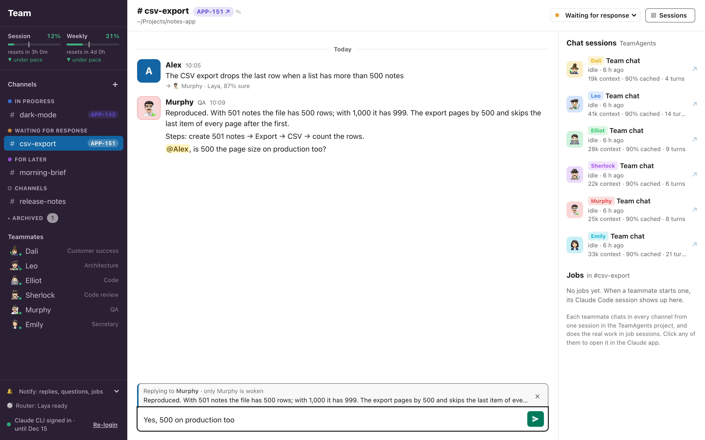
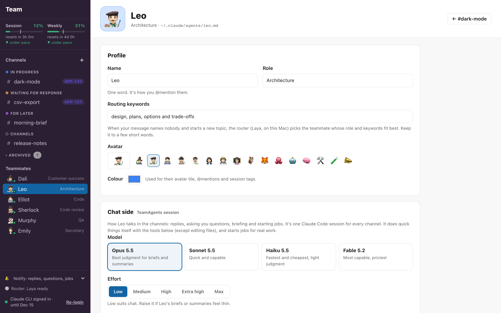

<h1><picture><source media="(prefers-color-scheme: dark)" srcset="docs/brand/lockup-white.svg"></picture></h1>

A local group chat, laid out like WhatsApp, with the six teammates in `~/.claude/agents`
(Dali, Leo, Elliot, Sherlock, Murphy, Emily). It used to be called Team Chat.


Each teammate is a Claude Code agent. They talk in channels, hand work to each
other with @mentions, and start Claude Code jobs for real work. You approve
their permissions and new tools from cards in the chat.

| Replies and Mozart | Right-click menus | A teammate's settings |
| --- | --- | --- |
|  |  |  |
| A reply wakes only the teammate you reply to. A message that names nobody goes to whoever the channel's Mozart picks. | Right-click a message, a channel or a teammate. | Name, role, routing keywords, avatar, colour, and the chat session's model and effort. |

<details>
<summary>Dark mode</summary>


</details>

The screenshots use made-up demo data and a made-up user, Alex:
`docs/screenshots/demo-data.py` builds the data, and `docs/screenshots/capture.mjs`
takes them from the demo server (its first line has the commands).

## Install

```bash
curl -fsSL https://raw.githubusercontent.com/ShaharIlany/harmonia/main/install.sh | bash
```

You need an Apple Silicon Mac and the
[Claude Code CLI](https://claude.com/claude-code), signed in. Nothing to build:
the script downloads the latest release, checks it against its SHA-256,
installs it in `~/Applications` and opens it. It also adds the six starter
teammates to `~/.claude/agents` (see [agents/README.md](agents/README.md)),
leaving any file you already have alone. From then on the app updates itself
from new releases. Run the script again any time to reinstall.

To build it yourself instead (an Intel Mac, or to follow a branch):
`HARMONIA_FROM_SOURCE=1` before `bash`. That needs Xcode's command line tools
(`xcode-select --install`) and [Bun](https://bun.sh).

No dependencies, no API key: everything runs on the `claude` CLI sign-in.

**Windows:** install `Harmonia-Setup-x64.exe` from a release for the app with its own window, or run
`harmonia-server.exe` from `Harmonia-windows-x64.zip` and open http://localhost:4747 in your browser. It needs the `claude` CLI on your PATH, signed in.
More in [Windows](docs/windows.md).

## First steps

Open the **Setup check** link at the bottom of the sidebar: it lists what Harmonia still needs (Claude Code
signed in, the agent files, the folders) and opens by itself when something is missing. The same page edits
`settings.json`; every key and environment variable is in [Settings](docs/settings.md).

## The main ideas

- **Mozart** picks who answers a message, or only a reaction, or nobody: [How it behaves](docs/behaviour.md).
- **Chat sessions and jobs:** each teammate has one chat session, and starts jobs for real work: [How it behaves](docs/behaviour.md).
- **Feedback:** ✎ on a message makes the teammate amend its own rules: [How it behaves](docs/behaviour.md).
- **Slack:** the teammates can talk in Slack through one app: [Slack](docs/slack.md).
- **Usage page:** your plan's usage and what the runs cost: [How it behaves](docs/behaviour.md).
- **Permissions:** what a channel's jobs may do without asking, and the macOS sandbox: [How it behaves](docs/behaviour.md) and [Settings](docs/settings.md).

## Run from source

```bash
bun server.ts          # real teammates, http://localhost:4747
bun run stub           # canned replies, no Claude runs, port 4748
bun test               # unit tests and one end-to-end run with stub teammates
```

Real teammates need the `claude` CLI signed in. More in [Development](docs/development.md).

## Documentation

- [How it behaves](docs/behaviour.md): chat sessions and jobs, Mozart, feedback, permissions, files, menus and the rest.
- [Slack](docs/slack.md): the Slack bridge, step by step.
- [The Mac app](docs/mac-app.md): `Harmonia.app`, updates over the air, notifications, coming from Team Chat or the Teams bridge.
- [Windows](docs/windows.md): the Windows server.
- [Releases](docs/releases.md): versions, the beta channel and promoting a build.
- [Settings](docs/settings.md): every `settings.json` key and environment variable.
- [Development](docs/development.md): the files, tests, the type check, stub mode and the Mozart eval.

## Brand

*Harmonia* first meant tuning a lyre's strings to each other, so the logo is a
solid lyre (white on dark, graphite on light) with six strings, red to violet.
The app icon puts it on a navy sky with a soft halo. The wordmark is Poppins,
and the app is graphite and cool greys: the strings are the colour. The logo,
app icon, colours and usage rules are in [docs/brand](docs/brand/guidelines.md).

## License

MIT, see [LICENSE](LICENSE).
