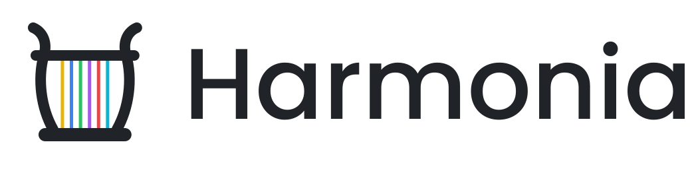

# Harmonia brand

**The mark ("Lyre"):** *harmonia* first meant fitting things together, then tuning a lyre's strings to each other.
The mark is a lyre with six strings, one per teammate, each in that teammate's colour. The frame is graphite on light
backgrounds and white on dark ones; the strings are the only colour. The app used to be called Team Chat; its old
brand is in `team-chat/`.

## Files

| File | Use |
|---|---|
| `mark.svg` | The mark, full colour: graphite frame, six coloured strings. On light backgrounds, 48 px and up. |
| `mark-reversed.svg` | The same with a white frame, for dark backgrounds. |
| `mark-small.svg`, `mark-small-reversed.svg` | Small cut: a heavier frame and wider strings, so the colour still reads. Below 48 px. |
| `favicon.svg` | The small cut with a frame that follows the browser: graphite in light mode, white in dark mode. |
| `mark-black.svg`, `mark-white.svg`, `mark-ink.svg` | One colour: print, stamps, single-colour surfaces. |
| `lockup.svg`, `lockup-white.svg` | Mark and wordmark side by side, for light and dark backgrounds. |
| `lockup-stacked.svg` | Mark above the wordmark, for square spaces. |
| `wordmark.svg`, `wordmark-white.svg` | Wordmark alone. |
| `app-icon.svg`, `app-icon-small.svg` | The macOS icon (1024 canvas), and its 16/32 px cut. |
| `board.html` | Final presentation board with mockups. `round-2/` holds the three concepts it was picked from (Bar, Lyre, Chord). |
| `make-brand.py` | Writes every SVG above. Change the numbers there, then run `python3 make-brand.py`. |
| `outline-wordmark.swift`, `wordmark-poppins.json` | The wordmark's outlines, taken from Poppins (see Type). |

The app icon itself is drawn by `macapp/make-icon.swift` from the same numbers. `macapp/build.sh` rebuilds the
`.icns` whenever that script changes. The favicon, the sidebar mark (`mark-small-reversed`) and the sidebar wordmark
are inline in `public/index.html`. If you change the mark, change all three.

## Colour

| Name | HEX | RGB | Where |
|---|---|---|---|
| Graphite | `#202328` | 32 35 40 | The frame on light, the wordmark, the band at the top of the chat list, buttons in light mode. |
| Graphite, dark | `#141518` | 20 21 24 | Panels in dark mode, the bottom of the icon tile. |
| Mist | `#E8E9EC` | 232 233 236 | Buttons and accents in dark mode (with graphite text). |
| White | `#FFFFFF` | 255 255 255 | The frame and wordmark on dark. |

The six strings, left to right in roster order: Dali `#EAB308`, Leo `#3B82F6`, Elliot `#22C55E`, Sherlock
`#A855F7`, Murphy `#EF4444`, Emily `#06B6D4` (the starter teammates' colours from `team.json`). The logo keeps these
fixed even if you change a teammate's colour in the app. There's no brand accent colour on purpose: the teammates are
the colour. Where seven colours are too many (print, embroidery, a stamp), use a one-colour version.

## Type

- **Wordmark:** "Harmonia" in [Poppins](https://fonts.google.com/specimen/Poppins) Medium, outlined into paths
  (`outline-wordmark.swift` → `wordmark-poppins.json`), so no file needs the font. Poppins is under the SIL Open Font
  License, which allows logo use. Its stem is about the lyre's 16-unit line, so mark and name have the same weight.
- **In the app:** the sidebar header shows the outlined wordmark next to `mark-small-reversed`. Body text stays the
  system font.

## Lines

The frame and yoke are 16 units on the 256 canvas, the sound box 20, the strings 5. The small cut uses 24 for the frame
and 9 for the strings.

## Space and size

- **Clear space:** at least two frame strokes (32 units on the 256 canvas) on every side of the mark or lockup.
- **Minimum size:** the mark at 16 px (use the small cut below 48 px); the lockup at 120 px wide.
- **Backgrounds:** white and light greys take the graphite frame; graphite and near-black take the white one. On a
  saturated colour, use the one-colour white or black version.

## Don't

- Don't recolour, reorder, add or drop strings. Six strings, in roster order.
- Don't put a graphite frame on a dark background, or a white one on a light background.
- Don't rotate or flip the mark, or straighten the horns.
- Don't set the wordmark live in another font, or squeeze it.
- Don't add gradients, shadows or outlines to the mark. (The app icon's tile has a soft gradient; the mark on it
  doesn't.)

## Notes

- The mark is original, drawn for Harmonia. No trademark search has been done.
- 16 px test: the horns, the yoke and the sound box still read, and the strings become one band of colour. Fine for a
  favicon; the small cut keeps that band from turning grey.
